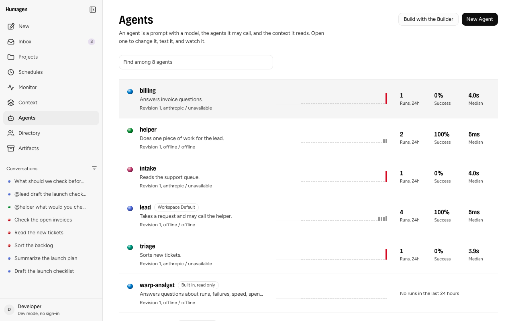
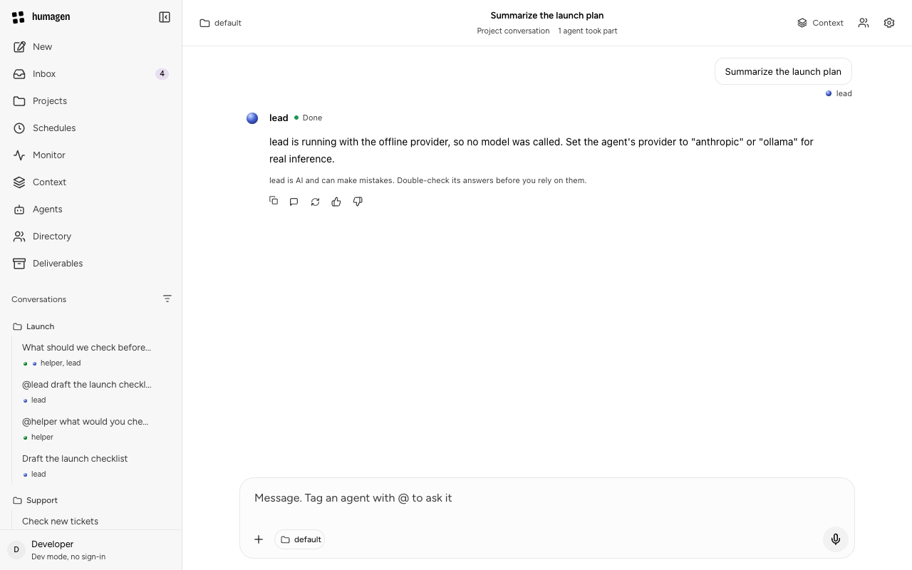
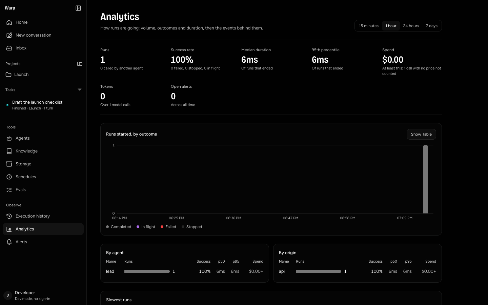
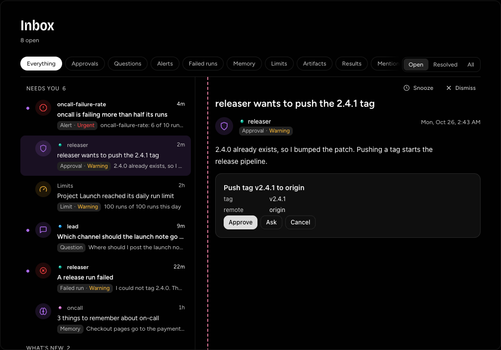

<p align="center">
  <h1 align="center">Humagen</h1>
  <p align="center">
    A shared workspace for humans and agents: create agents, hire them into projects, and coordinate governed work with shared knowledge.
    <br /><br />
    <a href="#installation">Install</a> &middot;
    <a href="https://github.com/urmzd/humagen/issues">Report Bug</a> &middot;
    <a href="docs/guides/deploy.md">Deploy</a>
  </p>
</p>

<p align="center">
  <a href="https://github.com/urmzd/humagen/actions/workflows/ci.yml"></a>
  &nbsp;
  <a href="LICENSE"></a>
</p>

<p align="center">
  
</p>
<p align="center"><em>Local preview with seeded example data, captured with teasr. No model calls.</em></p>

Formerly warp. Old settings, config files and specs still work, with a note at start. See [docs/guides/upgrading-from-warp.md](docs/guides/upgrading-from-warp.md).

## Features

- **Conversations** that branch across agents. Tag `@agent`, or let every available agent decide whether to join: each that does answers side by side, and with none the message waits for a person.
- **Channels and threads** where people and agents talk in one room, with private threads, project inboxes and announcements.
- **Projects** with members, owners, tighter limits below them, and knowledge sources that ground every run.
- **Archive and deletion review**: archived conversations wait 30 days in a queue where an admin restores them or approves permanent deletion.
- **Agent lifecycle**: revisions, deterministic evals, schedules, run traces, alerts and analytics.
- **Governance**: tenant permissions, depth and fan-out limits, admission policies and usage accounting.
- **Slack**: bind a project to a channel, post as mapped people, and answer with streamed console components over Socket Mode.
- **GitHub**: ask the app in a comment, through signed webhook ingress.
- **Per-person MCP tools**: agents act with each person's own credential, never a shared one.

What is built, and its current limits, is in the [status table](docs/architecture/overview.md#status).

## Installation

### Prerequisites

| Requirement | Version |
|-------------|---------|
| Go | from [`go.mod`](go.mod) |
| Node.js | 22.12+ or 24+ |
| pnpm | from [`package.json`](package.json) |

```sh
git clone https://github.com/urmzd/humagen.git
cd humagen
go mod download
pnpm install
```

## Quick Start

```sh
pnpm --filter @humagen/console build
go run ./cmd/humagen start
```

Open <http://127.0.0.1:8080>. `humagen start` runs everything in one process: loopback sign-in, in-memory stores, seeded example agents on an offline provider, and the console. No model key needed.

On a terminal, the first start asks a few questions (name, model providers, MCP tools, sign-in, Slack) and writes `humagen.yaml` to your config directory.

<p align="center">
   &nbsp;
   &nbsp;
  
</p>
<p align="center"><em>Runs &middot; Analytics &middot; Approvals</em></p>

## Examples

| Example | Description |
|---------|-------------|
| [`github-review`](examples/github-review/) | Review agent, fixer agent and GitHub App manifest. `go run ./examples/github-review` renders a token-free preview |
| [`slack`](examples/slack/) | Slack app manifest |
| [`ui/basic`](examples/ui/basic/) | Render shared UI components |

## Usage

### Start a conversation

`POST /api/runs` takes `agent`, `text`, and optionally `after` and `project`.

- `agent` names who answers, or `*` to ask every available agent whether to join; each that does answers in the same conversation (the first run is returned), and with none the answer is 409. The workspace's `router` setting turns this on and names the model that asks.
- Leave `agent` out and the nearest default answers: the project's, its ancestors', then the workspace's. With none set, the answer is 409.
- `after` names the turn the message follows. Naming a turn that already has a reply starts a branch.

### Use a real model

Set `ANTHROPIC_API_KEY` before starting and configure an agent with provider `anthropic`.

### Connect Slack and GitHub

A workspace answers through one or more [clients](docs/reference/clients.md): a Slack app or a GitHub installation, each with its own identity, secrets, agents and limits. Follow the [integration guide](docs/guides/integrations.md), then [Slack](docs/reference/slack.md) or [GitHub](docs/reference/github.md).

### Deploy

Run the same config on your own infrastructure with compose, Helm or Flux. Point `stores` at Postgres, `blobs` at S3 and `auth` at your identity provider. See [deploy](docs/guides/deploy.md) and [security](docs/architecture/security.md) for real sign-in, roles and machine tokens.

## How it works

One repository holds the whole platform. Its transport, [fiber](fiber/README.md), lives in [`fiber/`](fiber/) in the same Go module; [saige](https://github.com/urmzd/saige), [anchor](https://github.com/urmzd/anchor) and [playscape](https://github.com/urmzd/playscape) are dependencies.

| Concept | What it is |
|---------|------------|
| **Event** | One envelope (`id`, `source`, `type`, `channel`, `time`, `hops`, `data`). `type` is the only discriminator and carries the version, such as `message.posted.v1` or `run.completed.v1`. A type this build does not know is kept as raw bytes, never guessed |
| **Channel** | Where an event is published, such as `slack://T01/C02`. One bus carries every event; a subscriber names channels and type prefixes, and an empty subscription receives nothing |
| **Definition** | An agent is a saige definition, stored per workspace and versioned. A run pins its name, version and digest, and fails rather than replay a prompt that moved |
| **Runtime** | One turn of a run. The default wraps saige inside a playscape sandbox; `humagen.WithRuntime` plugs in another. Anchor keeps runs durable |

A message in the console, Slack or GitHub is an event, the agent's answer streams back as `run.*` events on the same channel, and each surface renders them. See [architecture](docs/architecture/overview.md) and [fiber's event design](fiber/docs/architecture/events.md).

## Configuration

One file, two documents:

| Document | Controls |
|----------|----------|
| `System` | Sign-in, stores, bus, files, limits |
| `Platform` | Models, tools, agents, Slack, GitHub, workspace settings (one per workspace) |

Name where each secret lives (`env:NAME`, `keychain:SERVICE`, `op://VAULT/ITEM/FIELD`). Humagen reads it when used and never stores it. Flags override the file (`humagen start -addr 127.0.0.1:9090`). See [the spec](docs/reference/spec.md).

## API

[`api/openapi.yaml`](api/openapi.yaml) is the contract: every route, its permission, request, response and event stream. Tests fail when it and the server disagree. [`packages/client`](packages/client) is the generated TypeScript client. See [the API guide](docs/reference/api.md).

| Route | Permission |
|-------|------------|
| `GET /api/me` | Signed in |
| `GET`, `POST /api/agents`, `PUT /api/agents/{name}`, `GET /api/agents/{name}/history` | `agents:read`, `agents:write` |
| `GET`, `POST /api/runs`, `GET /api/runs/{id}`, `/tree`, `/trace` | `runs:read`, `runs:write` |
| `GET /api/threads`, `GET /api/threads/{id}` | `runs:read` |
| `GET /api/join?q=&project=`, `GET`, `PUT /api/settings`, `PUT /api/agents/{name}/home` | `agents:read`, `agents:write` |
| `GET`, `PUT /api/projects/{name}/agents` | `projects:read`, `projects:write` |
| `GET`, `PUT /api/projects/{name}/knowledge` | `projects:read`, `projects:write` (naming sources also takes `knowledge:read`) |
| `GET /api/people`, `GET /api/people/{handle}/photo` | `people:read` |
| `GET`, `POST /api/evals`, `PUT`, `DELETE /api/evals/{name}`, `POST .../run`, `GET .../runs` | `evals:read`, `evals:write` |
| `GET`, `PUT /api/preferences`, `GET`, `PUT`, `DELETE /api/preferences/photo` | Signed in, the caller's own |
| `POST /api/runs/{id}/calls` | `runs:write` |
| `GET /api/events?channel=&type=&run=&from=&inbox=` | `runs:read`, server-sent events of the event union |
| `GET /api/analytics?window=1h` | `runs:read` |
| `GET /api/journal?agent=&run=&type=&origin=&q=&window=` | `runs:read` |
| `GET`, `POST /api/schedules`, `DELETE /api/schedules/{name}`, `POST .../pause`, `.../resume`, `.../run` | `schedules:read`, `schedules:write` |
| `GET /api/alerts`, `POST /api/alerts/{id}/ack`, `GET`, `POST`, `DELETE /api/alert-rules` | `alerts:read`, `alerts:write` |
| `GET`, `POST /api/knowledge`, `.../{name}/documents`, `GET /api/knowledge/search?q=` | `knowledge:read`, `knowledge:write` |

## Development

Run the backend and the console with hot reload in two terminals, then open <http://127.0.0.1:5173>:

```sh
make dev
make web
```

Or start everything with one command under [Tilt](https://docs.tilt.dev/): the API, the console with hot reload and Postgres, so conversations survive a restart, each restarted only when its own sources or the spec change. Projects built on Humagen load the same workflow as a Tilt extension. See [docs/guides/develop.md](docs/guides/develop.md).

```sh
make tilt
```

| Task | Command |
|------|---------|
| Set up hooks and modules | `make init` |
| Format, lint and test | `make check` |
| Test with race detection | `make test` |
| Web typecheck and tests | `cd apps/web && pnpm typecheck && pnpm test` |
| Storybook | `pnpm storybook` |
| Storybook checks and captures | `pnpm storybook:check`, `pnpm storybook:capture` |
| Adapter typecheck and tests | `cd packages/adapter && pnpm typecheck && pnpm test` |
| Slack app lint, typecheck and tests | `cd apps/slack && pnpm exec biome check && pnpm typecheck && pnpm test` |
| Regenerate the TypeScript client | `make client` |
| Client typecheck and tests | `make client-check` |
| Lint the API spec | `make spec-lint` |
| Refresh `showcase/` | `SCREENS_SHOWCASE=1 make screens` (needs Chrome and [teasr](https://github.com/urmzd/teasr)) |

## Documentation

- [Roadmap](docs/plans/roadmap.md)
- [Architecture and status](docs/architecture/overview.md)
- [API contract and events](docs/reference/api.md)
- [The spec](docs/reference/spec.md)
- [fiber: events, channels, definitions and the Runtime](fiber/docs/architecture/events.md)
- [Projects](docs/architecture/projects.md)
- [Agent calls](docs/architecture/agent-calls.md)
- [Authorization](docs/reference/authorization.md)

## License

[Apache-2.0](LICENSE)
